# ⚽ FutData Insights — Pipeline de Dados no Azure Databricks

Pipeline de engenharia de dados construído no **Azure Databricks** com **PySpark** e **SQL**, seguindo a **arquitetura medalhão (Bronze → Silver → Gold)** sobre o **Azure Data Lake Storage Gen2**. O objetivo é transformar dados brutos de futebol, em formatos variados, em tabelas confiáveis para análise de desempenho de um clube da Série A do Campeonato Brasileiro.

---

## 📌 Contexto do projeto

A **FutData Insights** é uma empresa de análise esportiva que fornece insights baseados em dados para times de futebol profissional. Ao fechar seu primeiro contrato com um clube da **Série A**, que enfrenta dificuldade para manter regularidade de resultados, o desafio é:

> Receber dados em formatos heterogêneos (resultados de partidas, times, jogadores, estádios e torneios), organizá-los e prepará-los para gerar insights que ajudem o clube a entender os fatores que afetam seu desempenho.

Este repositório cobre a **fundação de dados** desse trabalho: ingestão, padronização, modelagem e as primeiras explorações analíticas.

---

## 🏗️ Arquitetura

```mermaid
flowchart LR
    subgraph Bronze["🥉 Bronze (dados brutos)"]
        B1[torneios.csv]
        B2[estadios.csv]
        B3[times.json]
        B4[jogadores.json]
        B5[partidas/*.csv<br/>um arquivo por temporada]
    end

    subgraph Silver["🥈 Silver (limpo, Parquet)"]
        S1[torneios]
        S2[estadios]
        S3[times]
        S4[jogadores]
        S5[partidas<br/>particionada por ano_torneio]
    end

    subgraph Gold["🥇 Gold (modelo analítico, Delta)"]
        G1[ft_partidas]
        G2[dim_times]
        G3[dim_estadios]
        G4[dim_torneios]
        G5[dim_jogadores]
    end

    Bronze -->|PySpark: leitura, renomeação,<br/>tipagem, dt_ingestao| Silver
    Silver -->|Joins, enriquecimento<br/>e modelagem| Gold
    Gold --> C[Análises em PySpark e SQL]
```



| Camada | Container | Formato | O que acontece |
|---|---|---|---|
| **Bronze** | `bronze` | CSV e JSON | Dados brutos, exatamente como recebidos |
| **Silver** | `silver` | Parquet | Colunas padronizadas, tipos corrigidos e coluna de auditoria `dt_ingestao` |
| **Gold** | `gold` | Parquet e tabelas Delta (schema `futdata`) | Fato e dimensões prontas para consumo |

**Tecnologias:** Azure Databricks · Azure Data Lake Storage Gen2 · PySpark · Spark SQL · Delta Lake · Unity Catalog · Databricks Workflows

---

## 📥 Fontes de dados

| Arquivo | Formato | Particularidades tratadas |
|---|---|---|
| `torneios.csv` | CSV (UTF-16) | Conversão da coluna `e_atual` para booleano |
| `estadios.csv` | CSV (UTF-16) | Padronização de colunas |
| `times.json` | JSON | Schema explícito; `founded` convertido de double para inteiro |
| `jogadores.json` | JSON | Schema explícito com **struct aninhado** (`birth`: data, local e país) |
| `partidas/` | Vários CSVs (um por temporada) | **Encodings misturados** (UTF-8 e UTF-16), unificados em um único DataFrame |

---

## ⚙️ Pipeline de ingestão (Bronze → Silver)

Cada notebook segue o mesmo padrão **Ler → Transformar → Escrever**:

1. Ler o arquivo bruto do Data Lake.
2. Renomear as colunas para **português em snake_case**, com prefixos que indicam o tipo de dado.
3. Definir o **schema/tipos** corretos.
4. Adicionar a coluna `dt_ingestao` (data e hora do processamento), via a função reutilizável `cria_coluna_data`.
5. Gravar em **Parquet** na camada Silver.

### Convenção de nomes

| Prefixo | Significado | Exemplo |
|---|---|---|
| `id_` | Identificador | `id_time`, `id_partida` |
| `nm_` | Nome | `nm_estadio`, `nm_juiz` |
| `cd_` | Código | `cd_pais` |
| `dt_` | Data | `dt_partida`, `dt_ingestao` |
| `qt_` | Quantidade | `qt_gols_casa` |
| `vl_` | Valor | `vl_capacidade` |
| `nr_` / `ds_` / `tp_` | Número / descrição / tipo | `nr_partida`, `ds_status`, `tp_grama` |
| `e_` | Booleano ("é...") | `e_atual`, `e_lesionado` |

### Destaques técnicos

- **Leitura de encodings mistos:** para a pasta `partidas/`, o código testa cada CSV em UTF-8 e, se a primeira coluna não for `id`, relê o arquivo em UTF-16 (`multiLine`). Todos são então unidos com `unionByName`.
- **Schema explícito em JSON:** `StructType` para `jogadores` e `times`, incluindo o campo aninhado `birth`.
- **Particionamento:** `partidas` é gravada com `partitionBy('ano_torneio')`, e a leitura usa `basePath` para recuperar a coluna de partição.
- **Reuso e parametrização:** o notebook `Ingerindo o arquivo genericos` recebe o nome da fonte por **widget** (`arquivo_fonte`) e atende `torneios` e `estadios` com o mesmo código. Funções e caminhos ficam centralizados em `funcoes` e `Variaveis`.
- **Orquestração:** o notebook `Workflow` encadeia as ingestões com `dbutils.notebook.run`, retornando uma mensagem de sucesso por arquivo.

---

## 🥇 Camada Gold — modelo analítico

| Tabela | Tipo | Descrição |
|---|---|---|
| `futdata.ft_partidas` | Fato | Partidas enriquecidas com cidade, país e `nm_localizacao` do estádio (join *left* com estádios); registros sem `id_torneio` são descartados |
| `futdata.dim_times` | Dimensão | Times |
| `futdata.dim_estadios` | Dimensão | Estádios |
| `futdata.dim_torneios` | Dimensão | Apenas torneios da temporada atual (`e_atual = True`) |
| `futdata.dim_jogadores` | Dimensão | Jogadores, com **idade calculada** em SQL a partir da data de nascimento e `local_nascimento` com `COALESCE` para valores ausentes |

Os dados são gravados em Parquet no container `gold` e registrados como **tabelas Delta** no schema `futdata`, para serem consultados também em SQL. Foi explorada a diferença entre **tabelas gerenciadas e externas** (com `External Location` e `Storage Credential` no Unity Catalog), além de documentação de colunas com `COMMENT`.

---

## 🔎 Análises exploradas (Módulo 5 e 6)

- **Agregações:** total e média de gols de mandantes e visitantes por temporada, contagens e distintos.
- **Filtros:** por torneio (`id_torneio = 71`, Brasileirão Série A) e temporada atual, usando as sintaxes de coluna e de expressão SQL.
- **Joins:** partidas com torneios, estádios e times (duas vezes, para mandante e visitante).
- **Window functions:** `dense_rank` e `row_number` para identificar, por temporada, o time com mais gols em casa e a partida com mais gols (ex.: temporada 2022).
- **Manipulação de datas:** `to_date`, `to_timestamp`, `datediff`, `date_add`, `date_sub`, `year`, `month`...
- **Spark SQL:** criação de databases e tabelas, `DESCRIBE EXTENDED`, consultas com `WHERE` e views temporárias.

---

## 📁 Estrutura do repositório

```
databricks_project_FutData/
├── Modulo 2/   # Configuração do acesso ao storage (Data Lake)
├── Modulo 3/   # Ingestão individual de cada fonte (Bronze → Silver)
├── Modulo 4/   # Notebook genérico com widget, funções, variáveis e Workflow
├── Modulo 5/   # Agregações, datas, filtros, joins, window functions e camada Gold
└── Modulo 6/   # Spark SQL, tabelas Delta e dimensões (Unity Catalog)
```

---

## ▶️ Como executar

1. Provisione um **Azure Databricks** e um **Storage Account (ADLS Gen2)** com os containers `bronze`, `silver` e `gold`.
2. Envie os arquivos de origem para o container `bronze`.
3. Configure o acesso ao storage **usando Databricks Secrets** (veja a seção de segurança abaixo).
4. Importe os notebooks para o workspace e ajuste os caminhos em `Modulo 4/Variaveis`.
5. Execute `Modulo 4/Workflow` para a ingestão completa (Bronze → Silver).
6. Execute `Modulo 5/Desafio - Partidas + Estádios` e `Modulo 6/Salvando dados em tabelas` para gerar a camada Gold.

---

- Migrar a Silver e a Gold para **Delta** com cargas incrementais (`MERGE`).
- Agendar o pipeline com **Databricks Workflows** e adicionar validações de qualidade de dados.
- Construir um dashboard com os insights para a comissão técnica.
